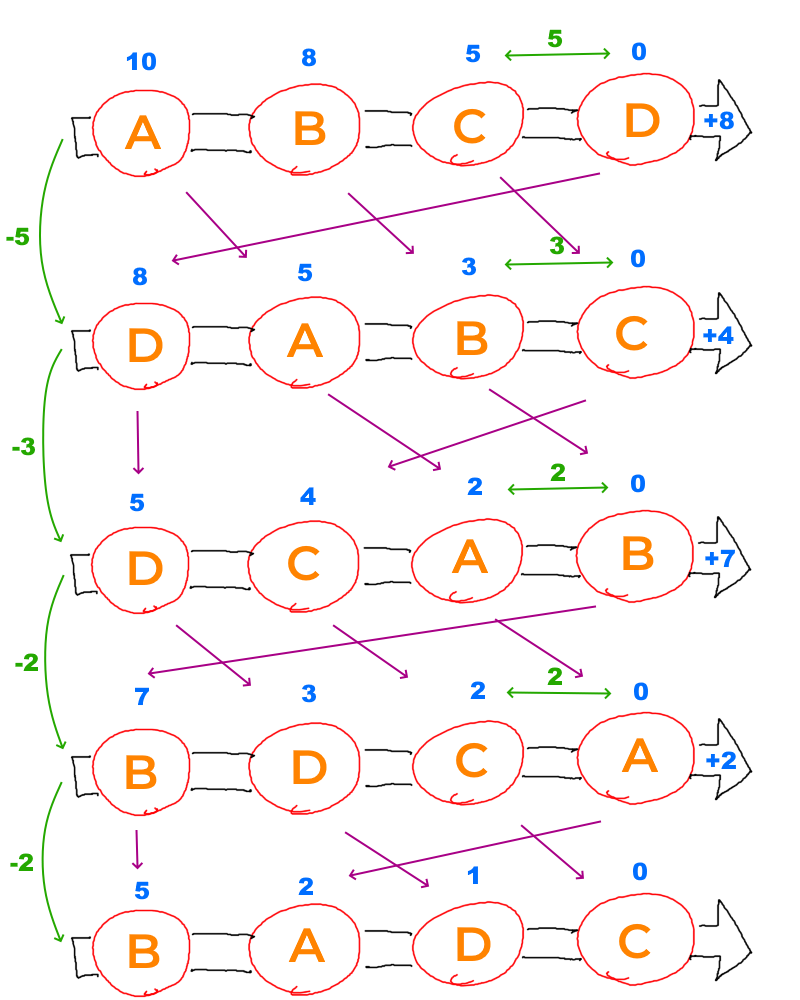
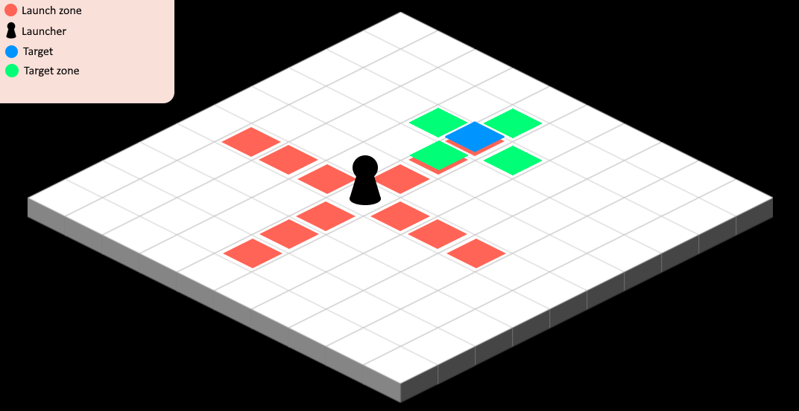
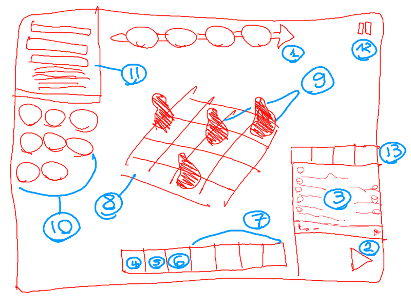

# Ghom Game — Realms of the Chaos

> RPG tactique en HTML5 sur grille **isométrique 2D à cases carrées**, avec des tours rythmés par une **timeline**.
> Alias interne : _« LE JEU VIDÉO PARFAIT DE LA MORT KI TUE »_.

**Statut : prototype jouable.** Un écran titre mène à trois modes hors ligne : **Escarmouche** (contre l'IA), **Duel local** (deux joueurs sur un écran) et **Arcade** (vagues successives, record). Les combats se jouent jusqu'à 3 contre 3, avec actions, zones, effets d'état, pouvoirs divins et écran de fin. Le moteur de combat est couvert par des tests automatisés, et **équilibré par simulation** : chaque personnage gagne environ la moitié de ses combats en 3 contre 3.

---

## Lancer le projet

Le projet est un **monorepo [Turborepo](https://turborepo.com)** géré avec [Bun](https://bun.sh) (≥ 1.3) : installation, serveur de dev, build et tests.

```bash
bun install
bun run dev        # serveur de dev du jeu → http://localhost:1234
bun run test       # tous les tests (moteur, rendu en DOM simulé, parties complètes)
bun run typecheck  # vérification des types (TypeScript 7)
bun run check      # Biome + typecheck + tests
bun run build      # build de production dans apps/game/dist/
bun run balance    # rapport d'équilibrage complet (≈ 1 min, voir « Équilibrage »)
bun run format     # formatage (Biome)
bun run lint       # formatage, imports et lint (Biome), sans rien modifier
```

Turborepo met en cache les résultats : une tâche dont les fichiers n'ont pas changé n'est pas relancée. On peut cibler un paquet avec `bunx turbo run test --filter=@realms/engine`, ou lancer `bun test` directement dans `packages/engine` ou `apps/game`.

Paramètres d'URL (`apps/game/src/params.ts`), surtout utiles en développement. Sans paramètre, le jeu s'ouvre sur l'écran titre.

| Paramètre              | Effet                                                                                     |
| ---------------------- | ----------------------------------------------------------------------------------------- |
| `?mode=skirmish`       | ouvre directement un écran : `title`, `skirmish`, `local`, `arcade`, `gallery` ou `fight` |
| `?seed=42`             | combat direct et reproductible (même carte, mêmes placements, même hasard)                |
| `?spectate`            | combat direct, IA contre IA                                                               |
| `?speed=4`             | vitesse des animations au démarrage (0.25 à 4 ; 0.25 = ralenti pour régler les effets)    |
| `?debug`               | expose le jeu et le runner dans la console (`window.game`, `window.runner`)               |
| `?gallery`             | galerie des personnages : 4 orientations et toutes les animations                         |
| `?team=eva,nyx,lyra`   | combat direct avec cette équipe (6 personnages max)                                       |
| `?enemies=gorr,merlin` | combat direct contre cette équipe                                                         |

Sans `mode`, les paramètres de combat (`seed`, `spectate`, `team`, `enemies`) lancent un combat directement, sans passer par l'écran titre.

### Modes de jeu

| Mode            | Déroulement                                                                                                                                                                                                                                                          |
| --------------- | -------------------------------------------------------------------------------------------------------------------------------------------------------------------------------------------------------------------------------------------------------------------- |
| **Escarmouche** | Votre équipe (1 à 3 Échos) contre une équipe de l'IA, tirée au hasard et relançable. Trois difficultés : Facile (stats de l'IA ×0,85), Normal, Difficile (×1,2).                                                                                                     |
| **Duel local**  | Deux joueurs sur le même écran. Le joueur bleu puis le joueur rouge choisissent leur équipe. En combat, un bandeau annonce l'équipe qui joue, et le panneau des pouvoirs divins suit l'équipe active.                                                                |
| **Arcade**      | Les **Marées** : des vagues de plus en plus nombreuses et fortes. Entre deux Marées, un bilan et le choix d'un bonus (soin complet, +10 % de puissance ou une recrue). La partie s'arrête à la première défaite. Le record est gardé dans le navigateur et affiché sur l'écran titre. |
| _Duel en ligne_ | Bientôt (comptes et serveur, phases 5 et 6).                                                                                                                                                                                                                         |
| _Chroniques_    | Bientôt (lore, phase 4).                                                                                                                                                                                                                                             |

**Choix d'équipe :**

- les 8 Échos sont animés, avec la fiche détaillée de celui qu'on survole ;
- on peut prendre plusieurs fois le même Écho ;
- la carte est tirée au hasard et relançable ;
- au clavier : flèches, `Espace` pour ajouter ou retirer, `Entrée` pour valider, `Échap` pour revenir, `D` pour la difficulté, `R` pour une autre carte.

**Écran titre et écrans de l'Arcade :** flèches et `Entrée`, ou la souris.

**En combat :** le bouton **Menu** ramène à l'écran titre. L'écran de fin propose de rejouer sur une nouvelle carte, de changer d'équipe ou de revenir au titre.

### Contrôles

| Entrée                        | Effet                                                                                         |
| ----------------------------- | --------------------------------------------------------------------------------------------- |
| Clic sur une case             | fixe la destination (gratuit, ne termine pas le tour)                                         |
| `C` ou icône de botte         | **Course** : jusqu'à 3 cases tout de suite, puis clic sur la destination (le tour se termine) |
| `1`–`9` ou clic sur une icône | sélectionne une action (combos compris), puis clic sur une cible                              |
| `Espace` / `Entrée`           | passe le tour                                                                                 |
| `Échap` / clic droit          | annule la sélection                                                                           |
| `F`                           | vitesse des animations ×1 / ×2 / ×4                                                           |
| Survol | infos du personnage, aperçu du chemin ou de la zone d'effet, et **coût en temps** du déplacement (marche : nombre de tours jusqu'à l'arrivée ; Course : équivalent en actions) |

## Vision

D'après le document de conception (Google Doc _« LE Jeu Vidéo Parfait. »_, lien dans [`docs/index.md`](docs/index.md)) :

- **Combats stratégiques et tactiques.** Chaque joueur contrôle une équipe de personnages et n'a pas de limite de temps pour jouer son tour.
- **Le joueur est un « Ghom »**, un Grand Maître de l'Existence. En plus des actions de ses personnages, il dispose d'**actions de player** (pouvoirs divins).
- **Modes de jeu prévus** :
  - rogue lite, en génération procédurale ;
  - aventure, avec un scénario et une fin ;
  - arcade, avec une difficulté croissante ;
  - libre : de 1 à 4 joueurs en local ;
  - en ligne, plus tard.
- **Actions combinées** entre personnages empilés sur la même case, et **progression des statistiques pendant le donjon**.
- **Jeu entièrement moddable**, en **low pixel-art 16×16**.

## Architecture

Le projet est séparé en deux paquets :

- **Le moteur (`packages/engine`, paquet `@realms/engine`)** est du TypeScript pur, sans Pixi ni DOM. Il contient toutes les règles, il est déterministe (RNG à seed) et testé avec `bun test`. Il servira tel quel au futur serveur de duel en ligne.
- **Le jeu (`apps/game`, paquet `@realms/game`)** ne fait que dessiner l'état du moteur et animer les événements qu'il émet.

```
package.json               workspaces Bun + scripts Turborepo
turbo.json                 tâches build / test / typecheck / dev
tsconfig.base.json         options TypeScript communes
packages/engine/
├── scripts/balance.ts     rapport d'équilibrage (bun run balance)
└── src/                   ── moteur de combat pur (aucune dépendance) ──
    ├── geometry.ts        Point, distances, ligne entre deux cases (ligne de vue)
    ├── random.ts          RNG à seed (mulberry32)
    ├── zones.ts           formes de zones : point, square, diamond, line, diagonal
    ├── board.ts           plateau : relief, eau, marches, Dijkstra, ligne de vue, génération procédurale
    ├── types.ts           stats, effets d'état, actions, combattants, événements
    ├── content.ts         contenu : personnages, spécialités, actions, combos, effets d'état, pouvoirs divins
    ├── combat.ts          la classe Combat : timeline, commandes, journal, rejeu, effets, victoire
    ├── ai.ts              IA : évaluation des actions, déplacement, pouvoirs divins
    ├── arcade.ts          mode Arcade : vagues, bonus, vérification d'une partie par rejeu
    ├── balance.ts         modèle de puissance, générateur de personnages équilibrés
    ├── tournament.ts      tournois IA contre IA (mesure de l'équilibrage)
    └── *.test.ts          tests (plateau, relief, eau, combat, combos, IA, commandes, Arcade, équilibrage)
apps/game/
├── index.html, assets/    page et feuille de style
└── src/
    ├── index.ts           bootstrap : Pixi 8, police, Runner booyah
    ├── params.ts          paramètres d'URL
    ├── art/
    │   └── pixelArt.ts    sprites 16×16 et icônes 8×8, stockés en texte (+ test)
    ├── storage.ts         record d'Arcade (stockage du navigateur, accès protégés)
    ├── view/              ── rendu PixiJS 8 + booyah ──
    │   ├── Game.ts        routeur d'écrans : titre → choix d'équipe → combat / Arcade
    │   ├── TitleScreen.ts écran titre : île flottante, titre, menu, record
    │   ├── TeamPicker.ts  choix d'équipe commun à tous les modes (et réglages)
    │   ├── ArcadeRun.ts   partie d'Arcade : vagues, bilans, bonus, record, enregistrement
    │   ├── MessageScreen.ts écran de message avec choix (bilans, fin de partie)
    │   ├── ui.ts          composants : textes, panneaux, boutons, menus au clavier
    │   ├── FightScene.ts  orchestre moteur ↔ animations ↔ entrées des joueurs
    │   ├── Backdrop.ts    ciel étoilé, poussières lumineuses
    │   ├── BoardView.ts   île flottante : colonnes de terrain, eau, décors, onde de choc, surbrillances
    │   ├── FighterView.ts pantin, PV, effets d'état, animations
    │   ├── Puppet.ts      personnages isométriques (pantins vectoriels articulés)
    │   ├── actionFx.ts    mise en scène des actions : poses, projectiles, impacts
    │   ├── Gallery.ts     page de contrôle des pantins (?gallery)
    │   ├── Hud.ts         timeline, barre d'actions, fiche, pouvoirs divins, journal, fin
    │   ├── effects.ts     particules, lumières, éclairs, entailles, projectiles, textes
    │   ├── textures.ts    pixel art → textures (filtrage nearest)
    │   ├── theme.ts       couleurs, tailles, projection isométrique
    │   ├── ViewChip.ts    chip booyah possédant un Container Pixi
    │   └── *.test.ts      tests du rendu (Pixi sans navigateur)
    └── test/
        ├── dom.ts         DOM simulé (happy-dom) et faux contexte canvas 2D pour Pixi
        ├── harness.ts     monter et faire « tiquer » des chips booyah dans les tests
        └── play.ts        jouer les équipes locales avec l'IA, via de vraies commandes
```

### Tests

`bun run test` lance 312 tests : 191 pour le moteur (**99,7 % des lignes couvertes**) et 121 pour le jeu, dont tous les fichiers sont couverts sauf `index.ts`, qui a besoin d'un vrai WebGL. Les tournois d'équilibrage du moteur prennent une vingtaine de secondes, et Turborepo ne les relance que si le moteur a changé.

- **Moteur** : règles du plateau et du relief, combat, combos, IA, et des centaines de combats IA complets sur des cartes générées, avec vérification d'invariants. S'y ajoutent le rejeu (un combat reconstruit depuis son journal de commandes est identique), l'Arcade (une partie truquée est refusée) et l'équilibrage (voir plus bas).
- **Rendu** : grâce à happy-dom et à un faux contexte canvas (`apps/game/src/test/dom.ts`), Pixi construit ses scènes sans navigateur. Sont testés les pantins (4 orientations, toutes les animations), le plateau (onde de choc, surbrillances, événements), les effets, le HUD, et des **parties entières animées**. Une partie IA contre IA et une partie jouée au clavier et à la souris vont jusqu'à l'écran de fin, et on vérifie que l'affichage correspond exactement au moteur (PV, positions, effets d'état). Les écrans sont testés aussi :
  - la navigation du titre ;
  - les règles du choix d'équipe ;
  - le routage complet (rejouer, changer d'équipe, quitter) ;
  - un duel local joué entièrement par les deux équipes ;
  - deux vagues d'Arcade jouées par l'interface, dont l'enregistrement est **rejoué par le moteur avec le même score**.

### Boucle de jeu

1. `FightScene` appelle `combat.advance()`. Le moteur traite le prochain événement de la timeline (un pas de déplacement ou un tour d'action), résout immédiatement les tours de l'IA et renvoie une liste de `FightEvent`.
2. La scène convertit ces événements en animations booyah (`Sequence` / `Parallel`) et les joue. La vue garde son propre état affiché (PV, position), qui peut être en retard sur le moteur le temps d'une animation.
3. Quand c'est au tour d'une équipe locale (`state === "awaitingInput"`), la scène envoie des `Command` sérialisées à `combat.execute()`, qui renvoie de nouveaux événements, ou un refus avec sa raison. Le moteur garde ces commandes dans son journal, et le duel en ligne les enverra au serveur par le même chemin.

### Commandes, rejeu et Arcade

- **Commandes sérialisables :** chaque ordre est aussi un objet `Command` (`moveTo`, `useAction`, `pass`, `useDivine`). `combat.execute(command)` refuse un ordre qui ne vient pas du personnage dont c'est le tour.
- **Journal et rejeu :** `combat.log` garde les commandes acceptées, et `Combat.replay(options, log)` reconstruit un combat identique, puisque le moteur est déterministe. C'est la base du futur duel en ligne et de la vérification des scores.
- **Difficulté :** chaque équipe peut recevoir un multiplicateur de stats (`statMultiplier` : PV, attaques et défenses multipliés, vitesse par la racine carrée) et des PV de départ (`hp`).
- **Arcade (`arcade.ts`) :** toute la logique est dans le moteur, l'écran (`ArcadeRun`) ne fait que l'afficher.
  - Des vagues générées depuis la seed de la partie : 2 à 4 ennemis, à 80 % de puissance à la première vague, puis +8 % par vague.
  - Les survivants récupèrent la moitié des PV perdus.
  - Entre deux vagues, on choisit un bonus : soin complet, +10 % de puissance, ou une recrue.
  - `verifyArcadeRun()` rejoue toute une partie pour en vérifier le score.

## Mécaniques de combat

### Timeline



Il n'y a pas de tours fixes. Chaque personnage a un **temps avant sa prochaine action**, et le plus bas joue. Son action ajoute `délai de base × coût de l'action` à son compteur, avec `délai de base = 100 / Vitesse`. Un personnage rapide joue donc plus souvent.

**Passer** redonne la main juste après le prochain **adversaire**, sans jamais coûter plus qu'une action (règle du doc). Passer après un allié permettait à deux alliés de se renvoyer le tour indéfiniment.

### Déplacement (option 👍 du doc)

Le doc pose le _« dilemme du déplacement suicidaire »_ et retient l'option **« déplacement à chaque fois que c'est possible »** :

- Fixer une destination est **gratuit et ne termine pas le tour**. Le pathfinder (Dijkstra) trace le chemin.
- Le personnage avance ensuite **d'une case à la fois pendant que la timeline s'écoule**. Chaque pas coûte `40 % × 100/√(Vitesse × 5) × coût du pas`, sans rien ajouter à son temps d'action. La marche dépend moins de la vitesse que les actions : un personnage lent au corps à corps n'est pas bloqué loin du combat.
- Un chemin bloqué en cours de route est recalculé, ou abandonné s'il n'y a plus de passage.
- Les déplacements se font en 4 directions. On traverse les cases de ses alliés (jusqu'à **3 personnages par case**), mais jamais celles des ennemis.

### Relief et terrain

Comme dans la version hexagonale d'origine, chaque case a une **hauteur, de -3 à +3**. Les creux sont soit secs (des fosses), soit remplis d'eau.

| Règle            | Effet                                                                                                                                                                                                      |
| ---------------- | ---------------------------------------------------------------------------------------------------------------------------------------------------------------------------------------------------------- |
| **Marche**       | On monte ou on descend **1 niveau** par pas. Au-delà, c'est une falaise, infranchissable. Monter coûte +1.                                                                                                 |
| **Eau**          | On se déplace **à la surface** (niveau 0). La profondeur compte : voir « L'eau » ci-dessous.                                                                                                               |
| **Ligne de vue** | Elle part des yeux (hauteur + 1). Une colline cache ce qui est derrière elle ; depuis les hauteurs, on voit par-dessus.                                                                                    |
| **Portée**       | +1 de portée par niveau au-dessus de la cible, +2 au maximum, pour les actions à distance.                                                                                                                 |
| **Repousser**    | Contre une falaise, 3 dégâts par case restante. Dans un creux, 5 dégâts par niveau de chute au-delà d'1, **sauf dans l'eau**. On ne peut jamais être poussé dans un trou d'où personne ne pourrait sortir. |

### L'eau

L'eau n'est **plus décorative**. Elle a deux profondeurs :

- **eau peu profonde** (1 niveau) : on y patauge ;
- **eau profonde** (2 ou 3 niveaux) : il faut savoir nager.

Chaque personnage a une **locomotion** :

| Locomotion    | Personnages                | Eau peu profonde                     | Eau profonde                                                                                                                                       |
| ------------- | -------------------------- | ------------------------------------ | -------------------------------------------------------------------------------------------------------------------------------------------------- |
| **Marcheur**  | Merlin, Brutus, Lyra, Gorr | patauge, coût 2                      | **impossible** (on ne nage pas en armure, et un golem coule)                                                                                       |
| **Nageur**    | Eva, Nyx                   | patauge, coût 2                      | nage à la surface : **coût 3 par case**, et chaque tour passé dans l'eau profonde coûte **+50 % de temps** (on dépense de l'énergie même immobile) |
| **Aquatique** | Néréa, Squalor             | **coût 1**, comme sur la terre ferme | **coût 1**, aucune pénalité                                                                                                                        |

Le moteur n'a pas de points d'action ni de mouvement : c'est la timeline qui rythme tout. « Dépenser plus de points » se traduit donc par **plus de temps** : des pas plus lents, et des tours plus longs quand on nage.

Autres règles liées à l'eau :

- **Repousser** : un marcheur poussé vers de l'eau profonde se cogne au bord (dégâts de collision) ; un nageur ou un aquatique tombe dedans. Tomber d'une falaise dans l'eau ne fait pas de dégâts.
- **Plongeon** (Squalor) : ce bond ne vise **que des cases d'eau** (champ `targetTerrain` des actions).
- **Séisme** : il reste permis tant que chaque combattant peut rejoindre la terre ferme commune ; un aquatique peut donc rester au milieu d'un lac.
- **À l'écran** : on patauge avec de l'eau jusqu'aux mollets, on nage immergé jusqu'au torse avec une animation de brasse. L'aileron de Squalor dépasse. La fiche du personnage indique son trait, et prévient quand il est en train de nager.

Les rochers ont été retirés : les falaises et les pitons jouent maintenant leur rôle (bloquer le passage et la vue).

La carte est générée de façon procédurale (collines et creux gaussiens) et **symétrique** (équitable pour les deux camps). Les mares sont fréquentes, les grands lacs rares. Les deux bords de départ sont praticables et reliés. Les personnages sont placés aléatoirement de leur côté, dans la zone praticable, **à 4 cases minimum de chaque ennemi** (règle du doc).

### Actions (« sorts »)



Le modèle suit le doc : `launch` (zone de lancement et portée), `lineOfSight`, `area` (zone d'effet), `target` (`enemy` / `ally` / `self` / `any` / `emptyCell`), `affects` (qui est touché dans la zone), `timeCost`, `cooldown` et `effects`.

Les effets sont **déclaratifs** : `damage` (physique ou magique), `heal`, `push` (avec dégâts de collision), `status`, `dash`, `delay`. Une action est donc entièrement décrite par des données, sans code.

**Dégâts** : `puissance × (1 + attaque/10) × 10/(10 + défense)`. Les coups critiques font ×1,5, avec une chance de `Chance × 3 %` (plafonnée à 50 %).

**PV** : `Santé × 7`.

**Érosion :** 15 % de chaque blessure réduit **définitivement** les PV max, qu'aucun soin ne peut rendre. Sans elle, deux équipes de soigneurs pouvaient se battre à l'infini. La barre de PV et la fiche affichent les PV max érodés.

### Personnages

| Perso       | Rôle                                 | Actions                                                                                               |
| ----------- | ------------------------------------ | ----------------------------------------------------------------------------------------------------- |
| **Merlin**  | Thermiste                            | Boule de feu (zone, **touche aussi les alliés**), Givre (ralentit)                                    |
| **Eva**     | Archère                              | Tir à l'arc (portée 2-6), Flèche empoisonnée (en ligne)                                               |
| **Brutus**  | Guerrier                             | Coup de bouclier (repousse de 2), Cri de guerre (enragé)                                              |
| **Lyra**    | Soigneuse                            | Soin, Champ (champ de force), Accélération                                                                  |
| **Nyx**     | Ombre                                | Lame furtive (rapide), Bond (saut sur une case libre)                                                 |
| **Gorr**    | Golem                                | Écrasement (zone), Secousse (retarde les ennemis adjacents)                                           |
| **Néréa**   | Ondine (aquatique, camp Ordre)       | Trident (portée 1-2), Raz-de-marée (zone : repousse et ralentit), Bulle protectrice (bouclier + soin) |
| **Squalor** | Homme-requin (aquatique, camp Chaos) | Morsure (saignement), Plongeon (bond dans l'eau qui éclabousse les ennemis autour)                    |

Tout le monde a aussi **Coup de pied** et la **Course** : avancer tout de suite jusqu'à 3 cases, en contournant les obstacles et en traversant les alliés. La Course coûte exactement le temps du trajet et termine le tour : plus besoin de passer plusieurs fois son tour pour avancer. L'IA ne s'en sert pas, ce qui laisse l'équilibrage intact.

Stats après équilibrage (la santé donne `Santé × 7` PV) :

| Perso   | Santé | Vitesse | Atq. phys. | Déf. phys. | Atq. mag. | Déf. mag. | Chance |
| ------- | ----- | ------- | ---------- | ---------- | --------- | --------- | ------ |
| Merlin  | 9,5   | 4       | 2          | 3          | 8         | 6         | 3      |
| Eva     | 6     | 6       | 7          | 3          | 2         | 3         | 7      |
| Brutus  | 13    | 4       | 8          | 7          | 1         | 3         | 3      |
| Lyra    | 8,75  | 6       | 2          | 4          | 6         | 7         | 4      |
| Nyx     | 6,75  | 8       | 7          | 3          | 3         | 3         | 8      |
| Gorr    | 17    | 4       | 7          | 9          | 1         | 2         | 1      |
| Néréa   | 6     | 6       | 5          | 4          | 6         | 6         | 5      |
| Squalor | 7,25  | 6       | 8          | 5          | 1         | 3         | 5      |

### Actions combinées (synergies du doc)

Chaque personnage a une **spécialité** : Merlin l'Énergie, Eva la Précision, Brutus et Gorr la Force, Lyra la Cohésion, Nyx l'Ombre. Dans le lore, une action combinée s'appelle une **Intrication**.

Quand un allié **se tient sur la même case**, une action combinée apparaît sur les deux personnages (jusqu'à 3 par case, donc 2 combos possibles). C'est **l'action principale du personnage, améliorée selon la spécialité du partenaire** :

| Partenaire | Bonus                                                                                                     |
| ---------- | --------------------------------------------------------------------------------------------------------- |
| Énergie    | +5 dégâts énergétiques, ou +3 de soin                                                                         |
| Force      | +30 % de dégâts et une case de recul en plus, **pour le même coût** (le « spé-force + spé-force » du doc) |
| Précision  | +2 de portée (+1 au corps à corps)                                                                        |
| Cohésion   | soigne aussi le lanceur (5 PV de base)                                                                    |
| Ombre      | coûte 40 % de temps en moins (le « bonus de temps » du doc)                                               |

Certaines paires ont une action unique, comme l'exemple du doc : **Eva + Merlin donnent la « Flèche incendiaire »**, une flèche de feu qui explose autour de la cible. Un combo a 1 tour de recharge de plus que l'action de base.

Dans la barre d'actions, les combos ont une bordure turquoise et le portrait du partenaire. L'IA les utilise, et elle se déplace sur la case d'un allié quand un combo y devient la meilleure option.
**Deux représentations par personnage :**

- **Sur le terrain : des pantins isométriques à la manière de Dofus** (`apps/game/src/view/Puppet.ts`). Ce sont des dessins vectoriels articulés (jambes, bras, torse, tête, arme), dessinés en vue de face ¾ et de dos ¾, puis retournés en miroir pour couvrir les 4 orientations. Un personnage se tourne vers sa destination ou vers sa cible. Il respire au repos et a des animations de marche, de coup, de tir, d'incantation, de cri et de réaction aux coups. Les gemmes, orbes et yeux brillent en lumière additive. L'apparence est décrite par des données (`STYLES`) : silhouette, couvre-chef, arme, couleurs.
- **Dans la timeline et la fiche : les sprites en pixel art 16×16** (`apps/game/src/art/pixelArt.ts`), un caractère par pixel, donc faciles à retoucher.

### Effets (« juicyness »)

- **Onde de choc** : toute action qui inflige des dégâts enfonce les cases de sa zone de quelques pixels, même s'il n'y en a qu'une. L'onde part de la case visée, se propage case par case, et fait légèrement trembler l'anneau autour. Les personnages suivent le sol.
- **Particules** : feu, fumée, poussière, étincelles, débris, éclaboussures (en marchant dans l'eau), bulles de poison, éclats de glace, scintillements.
- **Lumières** : halos additifs (explosions, soins, coups), énergie qui converge (Soin, Réparation), lentille de gravité (Distorsion), champ de force cristallin (Champ), éclairs (Accélération, Séisme), entailles (Lame furtive).
- **Tremblement d'écran** : explosions, Écrasement, Secousse, Séisme et coups critiques.
- **Décor** : l'île repose sur un faux empilement de blocs de terrain, une pyramide inversée irrégulière aux mêmes strates que le sol. L'eau des bords avant tombe en cascades le long des flancs et se perd en gouttelettes dans le vide. Autour, des îles lointaines construites de la même façon, bleutées par la distance. Tout flotte lentement, chaque île à son propre rythme.
- **Mort (la Dispersion)** : la chaleur et la lumière du personnage se répandent à l'horizontale et s'éteignent. Rien ne s'élève : il n'y a pas d'âme dans ce monde.

### Effets d'état (« états spéciaux » du doc)

Empoisonné (dégâts à chaque tour) · Ralenti (délais ×1,5) · Surexcité (délais ×0,7) · Protégé (bouclier qui absorbe les dégâts) · Enragé (+50 % de dégâts infligés, +20 % subis).

### Influences du Ghom (actions de player)

L'**Élan** (l'énergie du Ghom) **s'écoule avec le temps de la timeline** : chaque équipe gagne 1 point d'Élan toutes les 25 unités de temps (6 au maximum), et non plus à chaque tour, ce qui empêchait de la « farmer » en multipliant les tours courts. Les pouvoirs ne terminent pas le tour.

**Rattrapage :** une équipe qui perd un personnage gagne **1 énergie immédiatement**, et sa recharge s'accélère de **50 % par allié tombé**. Une équipe en infériorité garde ainsi des moyens d'agir, sans pouvoir retourner à coup sûr une partie perdue.

| Pouvoir               | Coût | Effet                                                                                                     |
| --------------------- | ---- | --------------------------------------------------------------------------------------------------------- |
| Distorsion            | 3    | avance de 25 le tour d'un allié, ou retarde de 25 celui d'un ennemi                                       |
| Séisme                | 4    | soulève une case basse de 2 niveaux, ou effondre une case haute de 2, sans jamais séparer les combattants |
| Réparation            | 5    | répare toute l'équipe, la chaleur rejetée s'échappe en vapeur                                             |

### IA

`ai.ts` note chaque couple action/cible :

- dégâts attendus, avec un bonus pour les éliminations ;
- tirs alliés, fortement pénalisés ;
- soins utiles (PV réellement manquants) ;
- valeur des effets d'état : bouclier sur un allié blessé ou menacé (un ennemi à 4 cases ou moins), buffs seulement près d'un ennemi ;
- actions combinées disponibles sur sa case, ou sur celle d'un allié où elle peut se rendre.

Si aucune action ne vaut le coup, l'IA cherche la case accessible d'où elle aura la meilleure action, en tenant compte du coût du trajet. Elle utilise aussi les Influences du Ghom : Réparation quand l'équipe est blessée, Distorsion quand sa jauge d'Élan est pleine.

### Interface



Déjà en place :

- timeline : l'ordre de jeu, et au survol les **durées réelles** entre les tours, sur un axe de temps. Un clic garde cette vue, et le choix est mémorisé ;
- barre d'actions avec raccourcis, recharges et infobulles ;
- fiche du personnage (stats, effets d'état) ;
- panneau des Influences du Ghom (jauge d'Élan) ;
- journal de combat ;
- surbrillances : cases accessibles, aperçu du chemin, portée, cibles, zone d'effet ;
- combos signalés dans la barre d'actions (« Intrication ! » et halo turquoise quand on les utilise) ;
- jusqu'à 3 personnages par case, disposés en triangle et réduits pour garder le plateau lisible ;
- dans l'eau, les personnages pataugent (eau jusqu'aux mollets) ou nagent (immergés jusqu'au torse, avec une brasse animée) ;
- une commande tapée pendant une animation n'est pas perdue : elle s'exécute à la fin de l'animation ;
- écran de fin : rejouer sur une nouvelle carte, changer d'équipe ou revenir au titre ; bouton Menu pour quitter un combat ;
- en duel local, un bandeau annonce l'équipe qui joue, et la barre de PV montre l'érosion.

## Équilibrage

L'équilibrage est **mesuré, pas deviné** : des tournois IA contre IA en 3 contre 3, sans aucun bonus, avec des équipes tirées au hasard. Chaque combat est joué deux fois, **camps échangés**, pour annuler l'avantage de position et de carte.

**Les personnages de référence** ont été calibrés ainsi :

- Gorr a gagné en vitesse et son Écrasement est plus fort et plus rapide. Il n'était qu'à 29 % de victoires : plus de PV ne l'aidaient pas, il lui manquait du débit.
- Lyra a gagné en vitesse.
- Les soins et la Boule de feu ont été retouchés.
- La santé de chacun a été ajustée.

**Résultat sur 800 combats :** chaque personnage gagne entre 45 et 55 % de ses combats, et le premier camp 50 %.

### Le modèle de puissance (`balance.ts`)

- **Principe (loi de Lanchester) :** un personnage vaut sa **résistance** multipliée par son **débit** (dégâts ou soins par unité de temps). Les deux découlent directement des formules du moteur.
- **Mesures par simulation :** des comparaisons appariées, où une variante remplace le personnage de référence dans une équipe identique, ont donné les ajustements suivants.

| Facteur            | Effet mesuré                                                                                                                                |
| ------------------ | ------------------------------------------------------------------------------------------------------------------------------------------- |
| Santé              | rendement décroissant : exposant 0,75 au corps à corps, 0,55 à distance (on encaisse moins), 0,3 pour les soigneurs (on vaut par ses soins) |
| Fragilité          | sous 60 PV, chaque PV vaut beaucoup plus : on peut tomber sur un seul combo ou un critique                                                  |
| Vitesse            | exposant 1,25, et 1,35 au corps à corps (il faut aussi aller au contact)                                                                    |
| Attaque            | exposant 1,3 (tuer plus vite, c'est aussi subir moins longtemps)                                                                            |
| Défenses et chance | exactement selon les formules de dégâts et de critiques                                                                                     |

- **Ce qui n'est pas modélisé :** la valeur relative des **kits** (portée, zones, effets d'état, usage par l'IA). Chaque kit est calibré par simulation sur son personnage de référence.
- **`healthFor(stats, kit, puissance)`** résout la santé qui garde la puissance constante : **moins de PV, c'est plus de force, de vitesse ou de défense**, et inversement.
- **`generateCharacter(seed, kit)`** tire des stats au hasard (jusqu'à ×1,33 ou ÷1,33 par rapport au personnage de référence), puis résout la santé.
- **`STAT_LIMITS`** borne les stats (santé de 5 à 20, vitesse de 3,5 à 9…). Hors de ces bornes, le modèle ne tient plus : un personnage trop lent joue trop rarement, un personnage trop fragile tombe en un combo. Le futur créateur de personnage utilisera ces mêmes règles.
- **Personnages complets dans le moteur :** `Combat` accepte un personnage complet à la place d'un identifiant, donc les personnages générés ou créés par les joueurs combattent normalement, combos compris.

### Les tests

**Version courte, dans `bun test` (`balance.test.ts`) :**

- les 8 personnages de référence, et 16 personnages générés, gagnent chacun entre 35 et 65 % de leurs combats (environ ±3,5 écarts-types) ;
- le premier camp n'a pas d'avantage ;
- les combats ont une durée raisonnable (5 à 18 actions par personnage) ;
- chaque action est réellement utilisée par l'IA.

**Version longue, `bun run balance` :**

- taux de victoire de chaque personnage, avec l'objectif de 40 à 60 % ;
- matrice des affrontements (équipes avec X contre équipes avec Y) ;
- répartition des actions ;
- compositions les plus fortes ;
- tournoi de 24 personnages générés, qui restent entre 42 et 59 %.

## Écarts entre le document de conception et le code

Le Google Doc n'a pas été mis à jour après plusieurs décisions. **Pour ces points, c'est le code qui fait foi.**

| Sujet                 | Document de conception                                                       | Code actuel                                                                                                                                                                                            |
| --------------------- | ---------------------------------------------------------------------------- | ------------------------------------------------------------------------------------------------------------------------------------------------------------------------------------------------------ |
| **Plateau**           | Grille hexagonale (texte), mais le schéma des sorts est en carré isométrique | **Isométrique 2D à cases carrées** (décision confirmée), 9×9, 4 directions                                                                                                                             |
| **Races / classes**   | Races et classes satiriques à combiner                                       | Supprimées. Chaque personnage a ses propres actions                                                                                                                                                    |
| **Statistiques**      | PA, PM, Portée, Charisme et Intelligence sont barrés                         | Vitesse, Vitalité, Attaque et Défense (physiques et magiques), Chance. Pas de PA ni de PM : c'est la timeline qui rythme. Les stats sont équilibrées par un modèle de puissance (voir « Équilibrage ») |
| **Énergie divine**    | —                                                                            | S'écoule avec le temps, avec un rattrapage pour l'équipe qui perd des personnages                                                                                                                      |
| **Érosion**           | —                                                                            | Ajoutée : 15 % des blessures sont définitives, pour que les combats finissent toujours                                                                                                                 |
| **Déplacement**       | Option 👍 « à chaque fois que c'est possible »                               | ✅ Implémenté                                                                                                                                                                                          |
| **Placement**         | Aléatoire, à au moins 4 cases des ennemis                                    | ✅ Implémenté                                                                                                                                                                                          |
| **Actions combinées** | Débloquées par l'empilement sur une case                                     | ✅ Implémentées (spécialités + paires nommées)                                                                                                                                                         |
| **Relief**            | Hauteurs et creux remplis d'eau, comme dans la version hexagonale            | ✅ De -3 à +3, falaises, chutes ; les rochers ont été remplacés par le relief                                                                                                                          |
| **Eau**               | « Les profondeurs sont uniquement décoratives »                              | ❌ Plus vrai : l'eau profonde ne se traverse qu'à la nage (nageurs, aquatiques), voir « L'eau »                                                                                                        |
| **Lore**              | Section « Univers étendu » entièrement barrée                                | —                                                                                                                                                                                                      |
| **Stack**             | THREE.js, jest, Parcel                                                       | PixiJS 8, `bun test`, Bun, Biome (pas de 3D)                                                                                                                                                                  |

## Notes techniques

- **`@ghom/utils` ≥ 1.1.5 obligatoire.** Jusqu'à la 1.1.4, `@ghom/utils` (importé par `@ghom/booyah` 1.3) ajoutait `pick`, `omit` et `partition` à `Array.prototype` en propriétés **énumérables**. PixiJS 8 parcourt certains tableaux avec `for…in` et plantait au démarrage (`ClassRef is not a constructor`). C'est corrigé dans la 1.1.5, et le `package.json` force cette version via `overrides`.
- **Les anciennes images de `assets/images/`** (sprites placeholder, gauges, cercles) ne sont plus utilisées : tout le visuel est maintenant généré à partir du pixel art en texte.

## Feuille de route

Le scénario de l'Aventure est rédigé dans [`docs/aventure/`](docs/aventure/README.md) : 5 ères, 28 chapitres, le Carnet des Questions et 5 fins. Son plan et ses fondements scientifiques sont dans [`docs/scenario.md`](docs/scenario.md).

La « coquille vide » du doc avance :

1. ✅ Des personnages (8)
2. ✅ Des ennemis et leur IA
3. ✅ Le moteur de combat, équilibré par simulation
4. 🚧 Les modes de jeu : Escarmouche, Duel local et Arcade sont jouables ; le duel en ligne, l'aventure et le rogue lite restent à faire

En cours (dans l'ordre) :

- [x] Écran titre, choix d'équipe, et les modes Escarmouche (contre l'IA), Duel local et Arcade
- [ ] Créateur de personnage : stats réparties avec le modèle d'équilibrage, apparence modulaire (corps, tête, habits, couleurs, détails), personnages utilisables dans tous les modes
- [ ] Lore : le Voile, l'Ombre du Tout, les Ghoms, les Échos, et un écran Chroniques
- [ ] Comptes (OAuth Discord et Google), base PostgreSQL avec Prisma, profils, équipes favorites, classements
- [ ] Duel en ligne : serveur WebSocket qui fait autorité et rejoue les commandes, appariement par Elo
- [ ] Déploiement : jeu sur Vercel, serveur sur Render, base sur Neon

Plus tard :

- [ ] Aventure (héros issu du créateur de personnage, qui gagne habits, traits et compétences) et rogue lite
- [ ] Combos entre plus de 2 personnages, et davantage de paires nommées
- [ ] Sons, calés sur les effets (impacts, explosions, pas)
- [ ] Mettre à jour le Google Doc avec les décisions ci-dessus

## Licence

Licence propriétaire restreinte, voir [`LICENCE`](LICENCE). © 2023 Camille Abella (GhomKrosmonaute).
